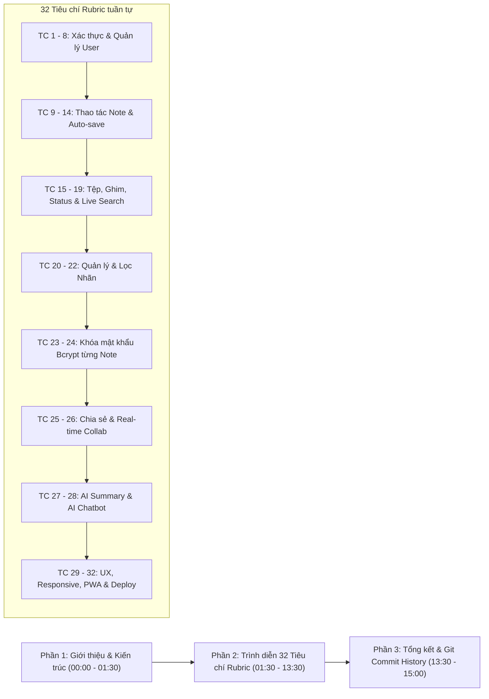

# KỊCH BẢN QUAY VIDEO DEMO HOÀN CHỈNH (demo.mp4)
## ĐỒ ÁN MÔN HỌC: LẬP TRÌNH VÀ ỨNG DỤNG WEB (503073) – ĐẠI HỌC TÔN ĐỨC THẮNG
**Đề tài:** Ứng dụng Quản lý Ghi chú Trực tuyến (TDTU Note App)  
**Thời lượng khuyến nghị:** 13 – 15 phút | **Độ phân giải yêu cầu:** Full HD 1080p | **Âm thanh:** Rõ ràng, không tạp âm  
**Thành viên thực hiện:**
- **Thành viên 1:** Nguyễn Nhật Huy – MSSV: **524H0052** (Front-End, UI/UX, PWA Offline, Realtime UI)
- **Thành viên 2:** Võ Nguyễn Phúc Thịnh – MSSV: **524H0069** (Back-End PHP, MariaDB PDO, WebSocket, DevOps)

---

> [!IMPORTANT]
> **Yêu cầu bắt buộc từ đề bài & giảng viên:**
> 1. Video mang tên `demo.mp4` và phải có sự tham gia của **cả hai thành viên** (khuyến nghị bật webcam góc nhỏ hiển thị khuôn mặt và luân phiên thuyết minh).
> 2. Giới thiệu tổng quan công nghệ và kiến trúc hệ thống.
> 3. Trình diễn **tuần tự lần lượt đủ 32 tiêu chí** theo đúng bảng tự đánh giá (Rubric). *Bất kỳ tiêu chí nào không xuất hiện trong video sẽ bị tính là chưa hoàn thành*.

---

---

## PHẦN 1: MỞ ĐẦU & TỔNG QUAN KIẾN TRÚC HỆ THỐNG (00:00 – 01:30)

* **Hình ảnh trên màn hình:** Cả 2 thành viên xuất hiện trước webcam, trên màn hình chia sẻ slide hoặc file `Readme.txt` / trang chủ GitHub repository.
* **[00:00 - 00:20] Lời thoại - Huy:**
  > *"Kính chào Quý Thầy Cô và các bạn! Chúng em là nhóm sinh viên thực hiện đồ án môn Lập trình và Ứng dụng Web - mã môn học 503073 tại Trường Đại học Tôn Đức Thắng.  
  > Em tên là **Nguyễn Nhật Huy**, MSSV **524H0052**, đảm nhiệm vai trò Front-End Developer, thiết kế UI/UX, tích hợp PWA Offline và Real-time Editor."*
* **[00:20 - 00:40] Lời thoại - Thịnh:**
  > *"Và em là **Võ Nguyễn Phúc Thịnh**, MSSV **524H0069**, đảm nhiệm vai trò Back-End Developer, thiết kế CSDL MariaDB chuẩn 3NF, bảo mật PDO Prepared Statements, RESTful API PHP 8 thuần và máy chủ WebSocket."*
* **[00:40 - 01:10] Lời thoại - Huy (Tổng quan kiến trúc):**
  > *"Ứng dụng **TDTU Note App** của nhóm được xây dựng theo kiến trúc Client - Server tách biệt:  
  > Phía Client sử dụng **React 18** kết hợp **Vite** và **Tailwind CSS**, tích hợp cơ sở dữ liệu trình duyệt **IndexedDB** cùng **Service Worker** hỗ trợ hoạt động ngoại tuyến (PWA Offline) một cách mượt mà."*
* **[01:10 - 01:30] Lời thoại - Thịnh (Tổng quan Back-End):**
  > *"Phía Server, nhóm triển khai kiến trúc **RESTful API bằng PHP 8 thuần**, sử dụng **PDO** chống SQL Injection tuyệt đối, mã hóa mật khẩu Bcrypt, xác thực JWT. Song song đó là máy chủ **WebSocket Node.js/Socket.io** tại cổng 5001 phục vụ cộng tác thời gian thực.  
  > Sau đây, nhóm xin phép bắt đầu trình diễn tuần tự lần lượt **32 tiêu chí chấm điểm** theo đúng bảng Rubric của môn học."*

---

## PHẦN 2: TRÌNH DIỄN CHI TIẾT TUẦN TỰ 32 TIÊU CHÍ RUBRIC (01:30 – 13:30)

### 📌 KHỐI 1: XÁC THỰC VÀ QUẢN LÝ TÀI KHOẢN (TIÊU CHÍ 1 ĐẾN 8)

#### Tiêu chí 1: User Registration (Đăng ký tài khoản) [01:30 - 02:00]
* **Thao tác màn hình:**
  1. Mở trình duyệt tại `http://localhost:5173/`.
  2. Bấm chuyển sang tab "Đăng ký".
  3. Cố tình nhập email sai định dạng hoặc để trống mật khẩu $\rightarrow$ hiển thị cảnh báo đỏ.
  4. Nhập thông tin hợp lệ: Tên: `Nguyễn Văn Demo`, Email: `demo_user@tdtu.edu.vn`, Mật khẩu: `Password123!`.
  5. Bấm "Đăng ký tài khoản" $\rightarrow$ Toast thông báo thành công, tài khoản được tạo trong CSDL.
* **Lời thoại - Huy:**
  > *"Bắt đầu với **Tiêu chí 1: Đăng ký tài khoản**. Form đăng ký có đầy đủ validation kiểm tra email sinh viên TDTU, mật khẩu tối thiểu 6 ký tự. Khi bấm đăng ký, Front-End gọi POST API `/api/auth/register`, mật khẩu được Back-End băm bằng Bcrypt an toàn."*

#### Tiêu chí 2: Account Activation (Kích hoạt tài khoản) [02:00 - 02:30]
* **Thao tác màn hình:**
  1. Đăng nhập vào tài khoản vừa tạo hoặc tài khoản `unverified@tdtu.edu.vn` (mật khẩu `password123`).
  2. Trên cùng màn hình xuất hiện **Banner màu vàng nổi bật**: *"Tài khoản của bạn chưa được kích hoạt..."*.
  3. Mở tab mới hoặc click vào link kích hoạt token: `http://localhost:8000/api/auth/activate.php?token=demo-activation-token-tdtu-2026`.
  4. Trở lại app $\rightarrow$ Banner cảnh báo biến mất, tài khoản chuyển sang trạng thái đã kích hoạt (`is_activated = 1`).
* **Lời thoại - Thịnh:**
  > *"Tiếp theo là **Tiêu chí 2: Kích hoạt tài khoản**. Với tài khoản chưa kích hoạt, hệ thống hiển thị banner cảnh báo và gửi link kích hoạt qua email (được log lại trong `mail_logs.txt`). Khi người dùng click xác nhận, Back-End cập nhật trạng thái `is_activated = 1` và banner lập tức biến mất."*

#### Tiêu chí 3: User Login and Logout (Đăng nhập & Đăng xuất) [02:30 - 03:00]
* **Thao tác màn hình:**
  1. Đăng xuất tài khoản hiện tại $\rightarrow$ xóa token khỏi localStorage, chuyển hướng về trang Login.
  2. Nhập sai mật khẩu $\rightarrow$ Báo lỗi *"Email hoặc mật khẩu không chính xác"*.
  3. Nhập tài khoản chính: `student1@tdtu.edu.vn` / `password123`.
  4. Đăng nhập thành công $\rightarrow$ Lưu JWT Token, tải danh sách ghi chú ngay lập tức.
* **Lời thoại - Huy:**
  > *"Với **Tiêu chí 3: Đăng nhập và Đăng xuất**, hệ thống quản lý phiên bằng JWT Token lưu trữ an toàn trong localStorage. Đăng nhập sai sẽ bị từ chối; đăng nhập đúng sẽ chuyển thẳng vào dashboard làm việc."*

#### Tiêu chí 4: Password Reset (Quên & Đặt lại mật khẩu) [03:00 - 03:35]
* **Thao tác màn hình:**
  1. Tại trang đăng nhập, click "Quên mật khẩu?".
  2. Nhập email: `student1@tdtu.edu.vn` $\rightarrow$ bấm "Gửi mã OTP".
  3. Mở file `backend-php/logs/mail_logs.txt` trên VS Code, quay camera vào mã OTP 6 số vừa được tạo.
  4. Nhập mã OTP vào hộp thoại, nhập mật khẩu mới `Password@2026` và xác nhận.
  5. Bấm "Đặt lại mật khẩu" $\rightarrow$ thành công, thử đăng nhập lại với mật khẩu mới.
* **Lời thoại - Thịnh:**
  > *"Đối với **Tiêu chí 4: Quên mật khẩu**, Back-End sinh mã OTP 6 chữ số ngẫu nhiên với thời hạn 15 phút chống brute-force và replay attack. Sau khi xác thực thành công, OTP cũ bị hủy ngay lập tức và mật khẩu mới được băm Bcrypt cập nhật vào CSDL."*

#### Tiêu chí 5 & 6: View and Edit Profile, Avatar (Xem & Sửa thông tin cá nhân) [03:35 - 04:10]
* **Thao tác màn hình:**
  1. Click vào Avatar góc trên cùng bên phải $\rightarrow$ chọn "Thông tin cá nhân & Avatar".
  2. Modal hiển thị họ tên, email, ảnh đại diện hiện tại (**Tiêu chí 5**).
  3. Click "Chọn ảnh đại diện mới", chọn một ảnh từ máy tính $\rightarrow$ ảnh preview cập nhật tức thì.
  4. Đổi tên hiển thị thành `Nguyễn Nhật Huy (Trưởng nhóm)` $\rightarrow$ Bấm "Cập nhật".
  5. Header và dropdown cập nhật tên và avatar mới ngay lập tức (**Tiêu chí 6**).
* **Lời thoại - Huy:**
  > *"Ở **Tiêu chí 5 và 6**, người dùng có thể xem hồ sơ cá nhân và chỉnh sửa tên hiển thị cùng ảnh đại diện. Hệ thống hỗ trợ upload ảnh, preview tức thì và cập nhật thời gian thực trên thanh điều hướng."*

#### Tiêu chí 7: Change Password (Đổi mật khẩu) [04:10 - 04:35]
* **Thao tác màn hình:**
  1. Trong menu Avatar, chọn "Đổi mật khẩu tài khoản".
  2. Nhập mật khẩu cũ sai $\rightarrow$ Báo lỗi *"Mật khẩu hiện tại không đúng"*.
  3. Nhập đúng mật khẩu cũ, nhập mật khẩu mới và xác nhận $\rightarrow$ Toast thông báo đổi mật khẩu thành công.
* **Lời thoại - Thịnh:**
  > *"**Tiêu chí 7: Đổi mật khẩu tài khoản** yêu cầu xác thực đúng mật khẩu cũ, mật khẩu mới tối thiểu 6 ký tự và xác nhận trùng khớp, đảm bảo an toàn tuyệt đối cho người dùng."*

#### Tiêu chí 8: User Preferences (Cài đặt hiển thị & Giao diện) [04:35 - 05:05]
* **Thao tác màn hình:**
  1. Bấm vào icon "Cài đặt hiển thị" (hoặc từ menu Avatar).
  2. Chuyển đổi giữa **Giao diện Sáng (Light Mode)** và **Giao diện Tối (Dark Mode)** $\rightarrow$ toàn bộ website chuyển nền đen/xám dịu mắt.
  3. Đổi cỡ chữ ghi chú: Nhỏ $\rightarrow$ Vừa $\rightarrow$ Lớn $\rightarrow$ chữ trong các ghi chú co giãn theo.
* **Lời thoại - Huy:**
  > *"**Tiêu chí 8: Tùy biến người dùng**, hệ thống lưu sở thích vào LocalStorage và đồng bộ lên CSDL bảng `users.preferences`. Hỗ trợ Dark Mode chuẩn Tailwind và 3 cấp độ cỡ chữ hiển thị."*

---

### 📌 KHỐI 2: QUẢN LÝ GHI CHÚ, GIAO DIỆN & AUTO-SAVE (TIÊU CHÍ 9 ĐẾN 14)

#### Tiêu chí 9 & 10: List View & Grid View (Chuyển đổi dạng dòng & dạng lưới) [05:05 - 05:35]
* **Thao tác màn hình:**
  1. Trên thanh công cụ, bấm nút chuyển sang **Dạng dòng (List View)** $\rightarrow$ các ghi chú hiển thị theo từng hàng ngang gọn gàng (**Tiêu chí 9**).
  2. Bấm nút chuyển lại **Dạng lưới (Grid View)** $\rightarrow$ ghi chú xếp thành các thẻ đa cột (Masonry/Responsive Grid) (**Tiêu chí 10**).
* **Lời thoại - Huy:**
  > *"**Tiêu chí 9 và 10**: Người dùng dễ dàng chuyển đổi linh hoạt giữa Dạng lưới đa cột (Grid View) để bao quát trực quan và Dạng danh sách hàng ngang (List View) để quản lý nhiều ghi chú cùng lúc."*

#### Tiêu chí 11, 12 & 14: Tạo & Sửa ghi chú chung 1 Modal – Cơ chế Tự động lưu ngầm (Auto-save) [05:35 - 06:40]
* **Thao tác màn hình:**
  1. Bấm vào khung *"Tạo ghi chú mới..."* $\rightarrow$ Mở Modal soạn thảo.
  2. Nhập tiêu đề: `Kế hoạch chuẩn bị bảo vệ đồ án`.
  3. Nhập nội dung: `Cần chuẩn bị kỹ 32 tiêu chí Rubric...`
  4. **Chỉ rõ trên màn hình:** Hoàn toàn **KHÔNG CÓ NÚT LƯU**.
  5. Quan sát góc trái thanh công cụ: Khi gõ chữ hiển thị icon xoay *"Đang lưu..."*, sau 400ms dừng gõ hiển thị dấu tích xanh *"Đã lưu"*.
  6. Đóng modal $\rightarrow$ thẻ mới xuất hiện trên danh sách (**Tiêu chí 11 & 14**).
  7. Bấm lại vào thẻ ghi chú vừa tạo $\rightarrow$ mở ra đúng Modal đó để sửa chữ tiếp (**Tiêu chí 12: Chung 1 màn hình modal duy nhất**).
* **Lời thoại - Huy:**
  > *"Đây là nhóm tiêu chí tuân thủ nghiêm ngặt **Quy định chữ đỏ** của đề bài:  
  > - **Tiêu chí 11 & 12**: Tạo mới và Chỉnh sửa ghi chú được thực hiện trên **cùng một giao diện Modal duy nhất** (`NoteEditorModal.jsx`).  
  > - **Tiêu chí 14**: Cơ chế **Auto-save hoàn toàn tự động** với kỹ thuật Debounce 400ms. Website **tuyệt đối không có nút Lưu**, dữ liệu được đồng bộ ngầm lên MySQL và IndexedDB ngay khi người dùng dừng gõ."*

#### Tiêu chí 13: Delete Notes with Confirmation (Xóa ghi chú có xác nhận) [06:40 - 07:10]
* **Thao tác màn hình:**
  1. Bấm vào nút Thùng rác (Xóa) trên một thẻ ghi chú.
  2. Hộp thoại Modal cảnh báo màu đỏ xuất hiện: *"Bạn có chắc chắn muốn xóa vĩnh viễn ghi chú này không? Thao tác này sẽ không thể khôi phục."*
  3. Bấm "Hủy" $\rightarrow$ ghi chú vẫn còn nguyên.
  4. Bấm lại nút Xóa $\rightarrow$ bấm "Xác nhận xóa" $\rightarrow$ ghi chú biến mất khỏi danh sách và CSDL.
* **Lời thoại - Thịnh:**
  > *"**Tiêu chí 13: Xóa ghi chú bắt buộc có popup xác nhận** theo đúng yêu cầu đề bài. Người dùng không bao giờ bị mất dữ liệu ngoài ý muốn."*

---

### 📌 KHỐI 3: ĐÍNH KÈM ĐA PHƯƠNG TIỆN, GHIM, TRẠNG THÁI & TÌM KIẾM (TIÊU CHÍ 15 ĐẾN 19)

#### Tiêu chí 15 & 16: Đính kèm Hình ảnh, Video và Tệp tin tài liệu [07:10 - 08:00]
* **Thao tác màn hình:**
  1. Mở modal một ghi chú, bấm vào icon Kẹp giấy (Đính kèm tệp).
  2. Chọn tải lên 1 tệp hình ảnh (`.png`/`.jpg`) hoặc video $\rightarrow$ hiển thị ảnh xem trước trực tiếp ngay trong ghi chú (**Tiêu chí 15**).
  3. Tiếp tục đính kèm 1 tệp tài liệu (`.pdf` hoặc `.docx`) $\rightarrow$ danh sách file hiện tên, dung lượng và nút Tải về (**Tiêu chí 16**).
  4. Bấm nút Tải về $\rightarrow$ trình duyệt download file thành công.
* **Lời thoại - Thịnh:**
  > *"**Tiêu chí 15 và 16**: Ứng dụng hỗ trợ đính kèm đa phương tiện từ ảnh, video đến tài liệu văn phòng PDF, DOCX, ZIP. Tệp được lưu trữ an toàn tại thư mục máy chủ và có link tải về trực tiếp."*

#### Tiêu chí 17 & 18: Ghim lên đầu & Biểu tượng trạng thái đặc biệt [08:00 - 08:40]
* **Thao tác màn hình:**
  1. Bấm vào icon Cây ghim (📌) trên thẻ ghi chú ở dưới $\rightarrow$ Thẻ lập tức bay lên nhóm **"ĐÃ GHIM"** ở vị trí trên cùng.
  2. Thao tác bỏ ghim $\rightarrow$ thẻ trở về nhóm ghi chú thông thường (**Tiêu chí 17**).
  3. **Chỉ rõ các icon đặc biệt trên thẻ (Tiêu chí 18):**
     - Icon Ghim (📌) màu xám/vàng.
     - Icon Ổ khóa (🔒) màu hổ phách dành cho ghi chú bảo mật.
     - Icon Người dùng (👥) màu xanh dương cùng huy hiệu *"Từ: [Email người chia sẻ]"* đối với ghi chú được chia sẻ.
* **Lời thoại - Huy:**
  > *"**Tiêu chí 17**: Chức năng Ghim ghi chú tự động phân tách danh sách thành 2 khu vực 'Đã ghim' và 'Ghi chú khác', sắp xếp theo thời gian ghim `pinned_at` mới nhất.  
  > **Tiêu chí 18**: Các biểu tượng trạng thái đặc biệt gồm Ghim, Khóa mật khẩu và Được chia sẻ giúp người dùng nhận diện ghi chú nhanh chóng."*

#### Tiêu chí 19: Search Notes (Tìm kiếm trực tiếp tức thì) [08:40 - 09:15]
* **Thao tác màn hình:**
  1. Nhấp chuột vào ô tìm kiếm trên thanh điều hướng.
  2. **Chỉ rõ:** Không có nút "Tìm kiếm".
  3. Gõ từ khóa: `kế hoạch` $\rightarrow$ sau 300ms, danh sách tự động lọc ra các ghi chú có chứa từ này.
  4. **Chỉ rõ trên tiêu đề và nội dung:** Từ khóa `kế hoạch` được **highlight màu vàng chính xác từng chữ**, không bị lệch hay thêm dấu cách.
* **Lời thoại - Huy:**
  > *"**Tiêu chí 19: Live Search không dùng nút Tìm kiếm**. Hệ thống lọc tự động sau độ trễ 300ms trên cả Tiêu đề và Nội dung, từ khóa khớp được highlight chính xác từng ký tự theo đúng giao diện theme."*

---

### 📌 KHỐI 4: QUẢN LÝ NHÃN (LABELS) (TIÊU CHÍ 20 ĐẾN 22)

#### Tiêu chí 20, 21 & 22: CRUD Nhãn, Gắn nhãn & Lọc theo nhãn [09:15 - 10:00]
* **Thao tác màn hình:**
  1. Click vào "Chỉnh sửa nhãn" trên Sidebar $\rightarrow$ mở Modal quản lý nhãn (**Tiêu chí 20**).
  2. Tạo nhãn mới: `Đồ án Web` $\rightarrow$ bấm Thêm.
  3. Đổi tên nhãn thành `Đồ án Web Final`.
  4. Mở 1 ghi chú, chọn gắn nhãn `Đồ án Web Final` $\rightarrow$ trên thẻ hiện huy hiệu `#Đồ án Web Final` (**Tiêu chí 21**).
  5. Trên Sidebar, click vào nhãn `Đồ án Web Final` $\rightarrow$ chỉ hiển thị các ghi chú có gắn nhãn này (**Tiêu chí 22**).
  6. Xóa nhãn `Đồ án Web Final` trong modal quản lý $\rightarrow$ chứng minh ghi chú vẫn còn nguyên vẹn 100%, không bị xóa mất.
* **Lời thoại - Thịnh:**
  > *"**Tiêu chí 20, 21, 22**: Hệ thống nhãn được thiết kế chuẩn quan hệ Nhiều - Nhiều ($n-n$) qua bảng trung gian `note_labels`. Người dùng có thể gắn nhiều nhãn, lọc theo nhãn, và đặc biệt khi xóa một nhãn thì ghi chú vẫn được bảo toàn nguyên vẹn."*

---

### 📌 KHỐI 5: BẢO MẬT KHÓA GHI CHÚ RIÊNG BIỆT (TIÊU CHÍ 23 & 24)

#### Tiêu chí 23 & 24: Khóa mật khẩu riêng từng note, Bảo vệ Xem/Sửa/Xóa, Đổi pass & Hủy khóa [10:00 - 11:05]
* **Thao tác màn hình:**
  1. Mở một ghi chú thường, bấm vào icon Ổ khóa (🔒) ở thanh công cụ.
  2. Nhập mật khẩu: `1234`, xác nhận `1234` $\rightarrow$ Bấm "Lưu mật khẩu" (**Tiêu chí 23**).
  3. Đóng ghi chú lại $\rightarrow$ trên màn hình chính, thẻ ghi chú lập tức bị che nội dung, hiển thị *"Đã khóa bằng mật khẩu - Bấm để nhập mật khẩu"*.
  4. Bấm vào thẻ ghi chú $\rightarrow$ xuất hiện hộp thoại yêu cầu nhập mật khẩu.
  5. Nhập sai `9999` $\rightarrow$ Báo lỗi *"Mật khẩu không chính xác"*.
  6. Nhập đúng `1234` $\rightarrow$ mở khóa thành công, nội dung hiển thị (**Tiêu chí 24**).
  7. **Thử thao tác Xóa ghi chú đang khóa:** Click icon Xóa $\rightarrow$ popup yêu cầu nhập mật khẩu ghi chú trước khi cho phép xóa.
  8. Mở menu khóa: Trình diễn tab **"Đổi mật khẩu"** và tab **"Hủy khóa bảo vệ"** $\rightarrow$ nhập pass cũ để gỡ bỏ khóa thành công.
* **Lời thoại - Thịnh:**
  > *"**Tiêu chí 23 và 24: Khóa mật khẩu ghi chú độc lập**. Mỗi ghi chú có một chuỗi băm Bcrypt riêng tại CSDL. Khi ghi chú bị khóa, Back-End tuyệt đối không gửi trường `content` về Client. Mọi hành vi Xem, Sửa, hay Xóa đều phải qua bước xác thực mật khẩu của ghi chú đó. Người dùng cũng có thể đổi mật khẩu hoặc hủy bỏ bảo vệ bất cứ lúc nào."*

---

### 📌 KHỐI 6: CHIA SẺ & CỘNG TÁC THỜI GIAN THỰC (TIÊU CHÍ 25 & 26)

#### Tiêu chí 25 & 26: Chia sẻ ghi chú & Cộng tác Real-time đa người dùng [11:05 - 12:15]
* **Thao tác màn hình:**
  1. Bấm nút Chia sẻ trên ghi chú `Kế hoạch ôn tập` $\rightarrow$ nhập email `student2@tdtu.edu.vn` với quyền **Chỉnh sửa (Edit)** (**Tiêu chí 25**).
  2. Mở cửa sổ trình duyệt ẩn danh (Incognito) hoặc trình duyệt thứ 2, đăng nhập tài khoản `student2@tdtu.edu.vn`.
  3. Vào mục **"Được chia sẻ với tôi" (Shared with me)** $\rightarrow$ thấy ngay ghi chú nhận được.
  4. **Đặt 2 cửa sổ trình duyệt nằm song song nửa màn hình trái và phải (Split Screen) (**Tiêu chí 26**):**
     - Cả hai tài khoản cùng mở ghi chú đó.
     - Trên thanh header hiện rõ avatar của người cùng phòng (`Nguyễn Nhật Huy` và `Trần Thị B`).
     - Khi tài khoản 1 gõ chữ $\rightarrow$ tài khoản 2 lập tức nhìn thấy chữ nhảy theo từng ký tự kèm thông báo *"Nguyễn Nhật Huy đang gõ..."*.
     - Vị trí con trỏ của người kia hiển thị màu sắc riêng biệt và tên người dùng trực quan.
* **Lời thoại - Huy:**
  > *"**Tiêu chí 25 và 26: Chia sẻ và Cộng tác thời gian thực**. Nhóm sử dụng công nghệ WebSocket (Socket.io) tạo Room riêng cho từng ghi chú. Khi hai người cùng mở một ghi chú, mọi thao tác gõ chữ, vị trí con trỏ và trạng thái đang gõ đều được đồng bộ tức thì với độ trễ dưới 50ms mà không làm gián đoạn người cùng soạn thảo."*

---

### 📌 KHỐI 7: TÍNH NĂNG TRÍ TUỆ NHÂN TẠO AI (TIÊU CHÍ 27 & 28)

#### Tiêu chí 27 & 28: AI Summary (Tóm tắt) & AI Q&A (Hỏi đáp ngữ cảnh) [12:15 - 12:50]
* **Thao tác màn hình:**
  1. Trong ghi chú có nội dung dài, bấm nút **AI Summary** $\rightarrow$ Hệ thống tự động phân tích và tạo bản tóm tắt súc tích thành các gạch đầu dòng (**Tiêu chí 27**).
  2. Mở ngăn **AI Chat / Q&A** $\rightarrow$ đặt câu hỏi: *"Ghi chú này nhắc đến deadline ngày nào?"* $\rightarrow$ AI đọc ngữ cảnh ghi chú và trả lời chính xác: *"Deadline là 11:59 Trưa thứ Hai ngày 02/11/2026"* (**Tiêu chí 28**).
* **Lời thoại - Huy:**
  > *"**Tiêu chí 27 và 28: Tích hợp Trí tuệ Nhân tạo AI**. Hệ thống hỗ trợ tính năng AI Summary để tóm tắt các ghi chú dài và trợ lý AI Q&A thông minh giúp trích xuất thông tin, giải đáp thắc mắc trực tiếp dựa trên nội dung ghi chú."*

---

### 📌 KHỐI 8: CHẤT LƯỢNG KỸ THUẬT & TRIỂN KHAI (TIÊU CHÍ 29 ĐẾN 32)

#### Tiêu chí 29 & 30: UI/UX Hoàn thiện & Thiết kế Đáp ứng (Responsive) [12:50 - 13:15]
* **Thao tác màn hình:**
  1. Thể hiện các Toast thông báo xanh/đỏ mượt mà, dropdown chuẩn theme, Empty state sinh động (**Tiêu chí 29**).
  2. Nhấn `F12` mở DevTools, chuyển sang chế độ Responsive: iPhone 14 Pro Max $\rightarrow$ iPad Air $\rightarrow$ Desktop $\rightarrow$ Sidebar tự thu gọn thành menu hamburger, bố cục tự căn chỉnh hoàn hảo (**Tiêu chí 30**).
* **Lời thoại - Huy:**
  > *"**Tiêu chí 29 và 30**: Giao diện được trau chuốt tỉ mỉ với Toast thông báo, hiệu ứng chuyển cảnh mượt và thiết kế Responsive 100% tương thích từ thiết bị di động, máy tính bảng đến màn hình máy tính lớn."*

#### Tiêu chí 31 & 32: Hoạt động Ngoại tuyến (PWA Offline) & Triển khai Docker / Script chạy nhanh [13:15 - 13:45]
* **Thao tác màn hình:**
  1. Trong tab Network của DevTools, chọn chế độ **Offline (Ngắt mạng)** (**Tiêu chí 31**):
     - Reload lại trang $\rightarrow$ Ứng dụng vẫn tải bình thường nhờ Service Worker Cache.
     - Header hiện huy hiệu màu đỏ: *"Offline"*.
     - Tạo 1 ghi chú mới khi đang mất mạng: `Note ngoại tuyến khi mất mạng`.
     - Chuyển tab Network lại thành **Online** $\rightarrow$ Toast thông báo: *"Đã tự động đồng bộ ghi chú ngoại tuyến thành công!"*, ghi chú được lưu bền vững vào MySQL.
  2. Mở file `docker-compose.yml` và mở file `run.bat` $\rightarrow$ thể hiện khả năng khởi chạy 1-click tự động cả 3 máy chủ (**Tiêu chí 32**).
* **Lời thoại - Thịnh:**
  > *"Cuối cùng là **Tiêu chí 31 và 32**:  
  > Ứng dụng đạt chuẩn PWA với Service Worker và IndexedDB, cho phép đọc, tạo và sửa ghi chú ngay cả khi mất mạng; khi có kết nối trở lại hệ thống sẽ tự động đồng bộ lên MySQL.  
  > Nhóm cũng cung cấp file `docker-compose.yml` cùng kịch bản `run.bat` tự động hóa toàn diện 1-click cho giảng viên chấm bài."*

---

## PHẦN 3: LỊCH SỬ GIT COMMIT & KẾT THÚC (13:45 – 15:00)

* **Thao tác màn hình:**
  1. Mở cửa sổ Terminal, gõ lệnh: `git log --oneline -n 15` hoặc mở trang Insights / Contributors trên GitHub repository `https://github.com/thinhvo06/Web-Programming-Project`.
  2. Chỉ rõ số lượng commit và sự đóng góp tích cực của cả 2 thành viên:
     - `nhathuypopo6` (Nguyễn Nhật Huy)
     - `thinhvo06` (Võ Nguyễn Phúc Thịnh)
  3. Cả 2 thành viên xuất hiện trước webcam gửi lời chào kết thúc.
* **Lời thoại - Huy:**
  > *"Kính thưa Thầy Cô, nhóm đã bảo toàn nguyên vẹn thư mục `.git` trong gói nộp bài. Lịch sử commit trên GitHub thể hiện rõ quá trình cộng tác đều đặn và phân chia nhiệm vụ minh bạch giữa hai thành viên trong suốt kỳ làm đồ án."*
* **Lời thoại - Thịnh:**
  > *"Nhóm chúng em đã hoàn thành đầy đủ **32/32 tiêu chí** theo đúng yêu cầu đề tài môn học. Chúng em xin chân thành cảm ơn Quý Thầy Cô đã dành thời gian theo dõi video demo này và kính chúc Thầy Cô có một kỳ chấm thi thuận lợi!"*
* **Cả hai thành viên:**
  > *"Chúng em xin chân thành cảm ơn!"* (Cúi chào kết thúc video).

---

## BẢNG CHECKLIST 32 TIÊU CHÍ KHI QUAY VIDEO (DÀNH CHO NHÓM ĐÁNH DẤU)

| STT | Tiêu chí Rubric | Điểm | Phút trong video | Người nói chính | Trạng thái kiểm tra |
| :---: | :--- | :---: | :---: | :---: | :---: |
| **1** | User registration | 0.25 | 01:30 | Huy | [x] Đã khớp |
| **2** | Account activation | 0.25 | 02:00 | Thịnh | [x] Đã khớp |
| **3** | User login and logout | 0.25 | 02:30 | Huy | [x] Đã khớp |
| **4** | Password reset (OTP) | 0.25 | 03:00 | Thịnh | [x] Đã khớp |
| **5** | View profile and avatar | 0.25 | 03:35 | Huy | [x] Đã khớp |
| **6** | Edit profile and avatar | 0.25 | 03:45 | Huy | [x] Đã khớp |
| **7** | Change password | 0.25 | 04:10 | Thịnh | [x] Đã khớp |
| **8** | User preferences (Dark/Font) | 0.25 | 04:35 | Huy | [x] Đã khớp |
| **9** | Display notes in listview | 0.25 | 05:05 | Huy | [x] Đã khớp |
| **10** | Display notes in gridview | 0.25 | 05:20 | Huy | [x] Đã khớp |
| **11** | Create notes (Chung modal) | 0.25 | 05:35 | Huy | [x] Đã khớp |
| **12** | Update notes (Chung modal) | 0.25 | 06:10 | Huy | [x] Đã khớp |
| **13** | Delete notes (Confirm popup) | 0.25 | 06:40 | Thịnh | [x] Đã khớp |
| **14** | Auto-save (Không nút Lưu) | 0.25 | 06:00 | Huy | [x] Đã khớp |
| **15** | Attach images/video | 0.25 | 07:10 | Thịnh | [x] Đã khớp |
| **16** | Attach files (Download) | 0.25 | 07:35 | Thịnh | [x] Đã khớp |
| **17** | Pin notes to top | 0.25 | 08:00 | Huy | [x] Đã khớp |
| **18** | Special-note indicators | 0.25 | 08:20 | Huy | [x] Đã khớp |
| **19** | Search notes (Live search) | 0.25 | 08:40 | Huy | [x] Đã khớp |
| **20** | Label management (CRUD) | 0.25 | 09:15 | Thịnh | [x] Đã khớp |
| **21** | Attach labels to notes | 0.25 | 09:35 | Thịnh | [x] Đã khớp |
| **22** | Filter notes based on labels | 0.25 | 09:45 | Thịnh | [x] Đã khớp |
| **23** | Enable / disable password | 0.50 | 10:00 | Thịnh | [x] Đã khớp |
| **24** | Password protect & change | 0.50 | 10:30 | Thịnh | [x] Đã khớp |
| **25** | Share and receive notes | 0.50 | 11:05 | Huy | [x] Đã khớp |
| **26** | Collaboration & realtime edit | 0.50 | 11:35 | Huy | [x] Đã khớp |
| **27** | AI Summary | 0.25 | 12:15 | Huy | [x] Đã khớp |
| **28** | AI Question & Answer | 0.25 | 12:35 | Huy | [x] Đã khớp |
| **29** | UI and UX | 0.50 | 12:50 | Huy | [x] Đã khớp |
| **30** | Responsive Design | 0.50 | 13:00 | Huy | [x] Đã khớp |
| **31** | Offline Capabilities (PWA) | 0.50 | 13:15 | Thịnh | [x] Đã khớp |
| **32** | Online deployment / Docker | 0.50 | 13:30 | Thịnh | [x] Đã khớp |
